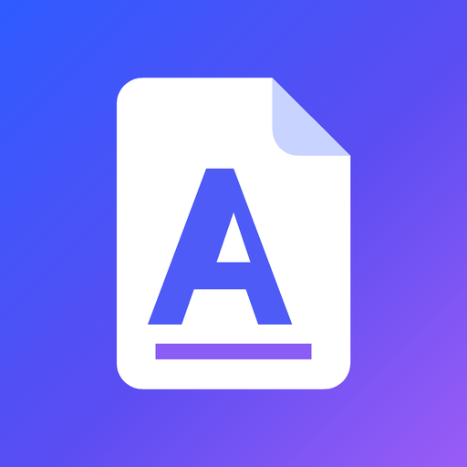
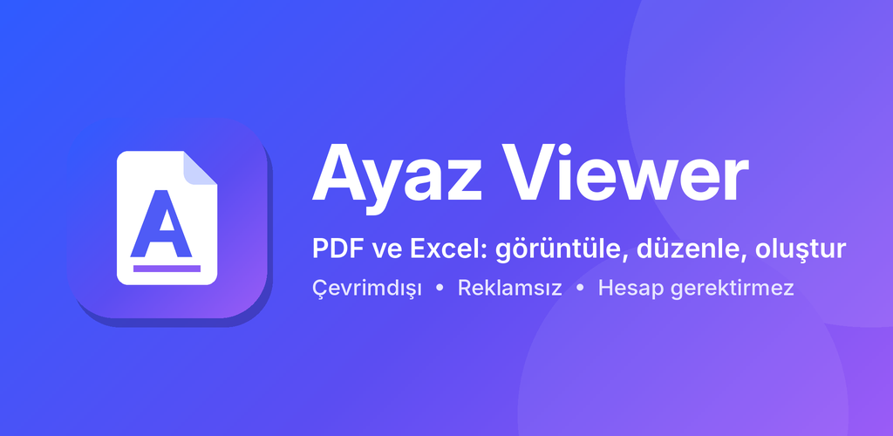
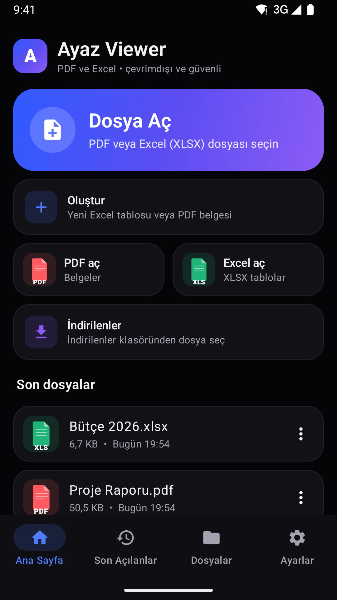
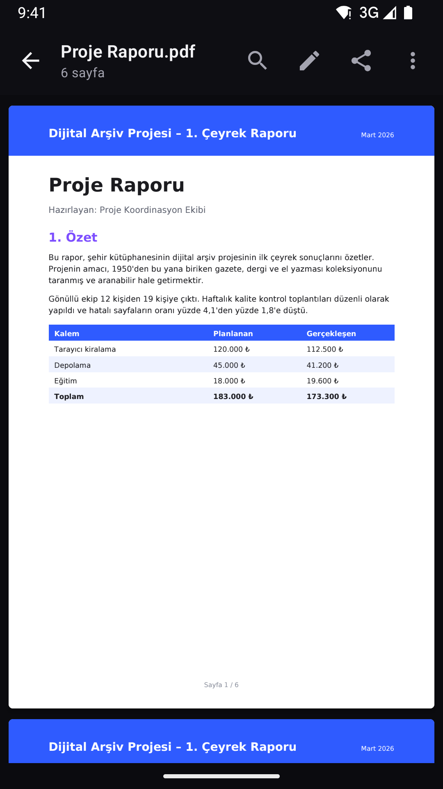
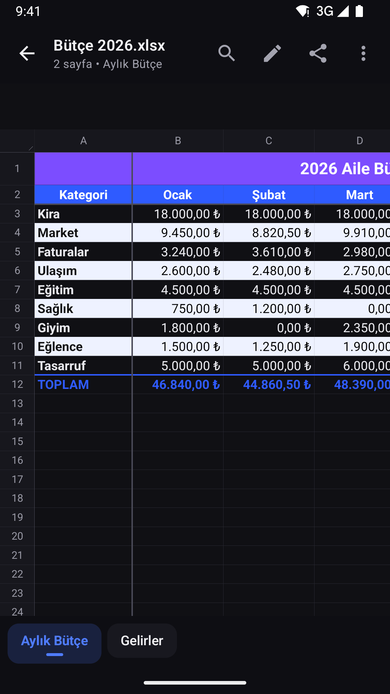
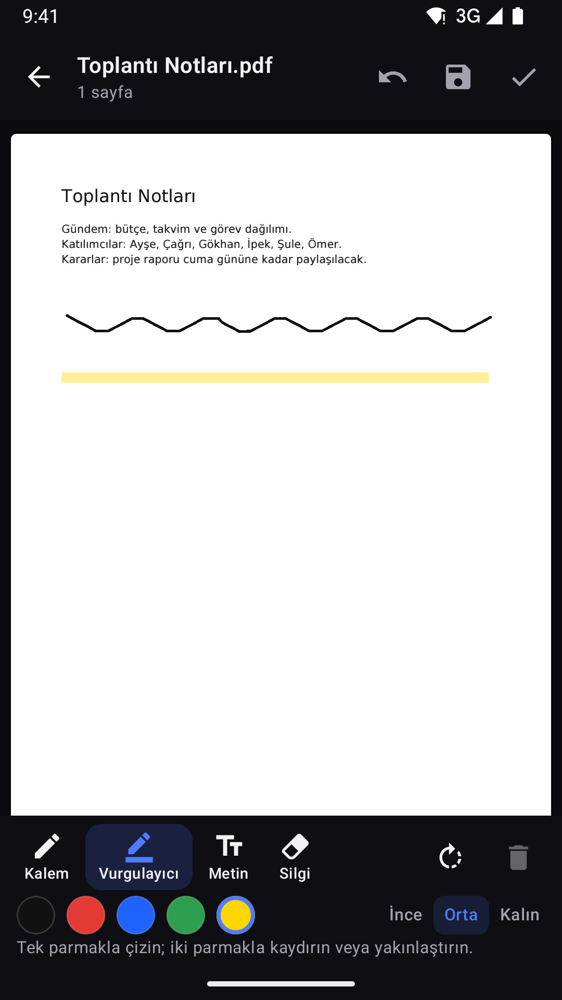

# Ayaz Viewer

**PDF ve Excel (XLSX) dosyalarını görüntüleme, düzenleme ve oluşturma** uygulaması (Android).
Tamamen çevrimdışı: internet izni, reklam, hesap ve takip yoktur.

## 📱 Telefona kurmak

1. **[AyazViewer-debug.apk](AyazViewer-debug.apk)** dosyasını açın → sağ üstteki **⬇ (Download raw file)** ile indirin.
2. Telefonda indirilen dosyaya dokunun. "Bilinmeyen uygulamaları yükle" izni sorulursa açın.
3. Play Protect uyarısı çıkarsa **Ayrıntılar → Yine de yükle**.

Yeni sürümleri eskisini kaldırmadan üzerine kurabilirsiniz. Android 8.0 ve üzeri gerekir.

## ✨ Neler yapabilir?

| | |
|---|---|
| 📄 **PDF** | Akıcı kaydırma, yakınlaştırma, sayfaya git, metin arama, kaldığınız sayfayı hatırlama |
| 📊 **Excel** | Gerçek tablo görünümü, sayfa sekmeleri, sayı/tarih biçimleri, renkler, birleşik hücreler, arama |
| ✏️ **Düzenle** | Excel'de hücre yazma, satır/sütun ekleme-silme; PDF'te kalem, vurgulayıcı, metin notu, sayfa döndürme/silme |
| ➕ **Oluştur** | Yeni Excel tablosu, metinden PDF, boş PDF |
| 📤 **Paylaş** | Yalnızca WhatsApp ve Telegram; gerçek dosya olarak, adı korunarak |
| 🔒 **Gizlilik** | İnternet izni yok, dosyalar hiçbir yere gönderilmez, siz kaydetmeden değiştirilmez |

  
  
  
  

## 📚 Belgeler

| Belge | İçerik |
|---|---|
| [KULLANIM.md](KULLANIM.md) | Tüm özellikler, nasıl kullanılır, bilinen sınırlamalar |
| [YAYINLAMA.md](YAYINLAMA.md) | **Google Play'de yayınlama** – adım adım |
| [magaza/](magaza/) | Play Store metinleri, simge, öne çıkan görsel, ekran görüntüleri |
| [GIZLILIK.md](GIZLILIK.md) | Gizlilik politikası (Play Console'a bu sayfanın bağlantısı girilir) |
| [TEST_RAPORU.md](TEST_RAPORU.md) | Gerçekten çalıştırılmış testler ve sonuçları |
| [GELISTIRICI.md](GELISTIRICI.md) | Teknolojiler, proje yapısı, derleme ve testleri çalıştırma |

## ⚙️ Otomatik derleme

Kodda her değişiklikte GitHub Actions uygulamayı derler, 90'dan fazla otomatik testi (Android 13 ve 15
emülatörlerinde) çalıştırır, yayın sürümünü uçtan uca dener ve testler geçerse güncel APK'yı ve ekran
görüntülerini bu klasöre ekler. İmzalama sırları tanımlıysa Google Play'e yüklenecek **AAB** dosyası da
[`yayin/`](yayin/) klasörüne eklenir ([nasıl?](YAYINLAMA.md#2-yükleme-anahtarı-imza)).
